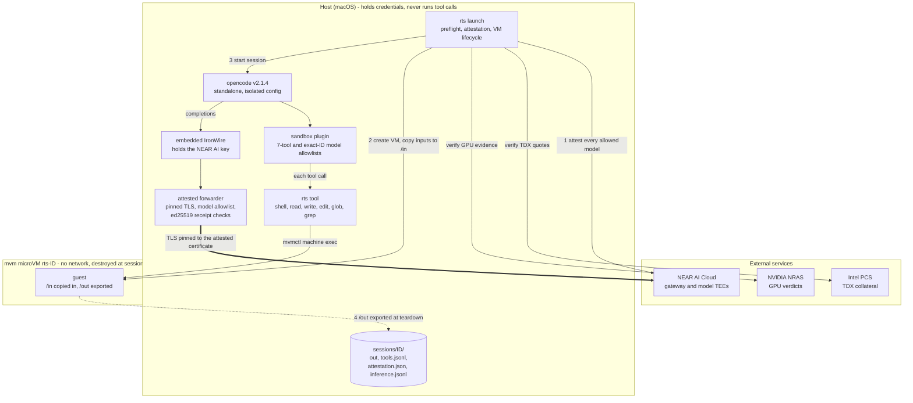

<p align="center">
  
</p>

# NEAR AI Red · SandBox

Cybersecurity Program

The microVM sandbox for **NEAR AI Red** (`near-ai-red`), supporting agentic
security research and red teaming.

This project is designed to run OpenCode tool calls inside an ephemeral microVM
per session, with guest networking disabled, inputs copied into the guest, and
results exported through `/out`. Inference runs on the host so provider
credentials stay outside the guest.

<p align="center"></p>

##  Quick start

```console
$ rts launch    # signs in when needed, then starts a sandboxed OpenCode session
$ rts login     # optional: sign in to NEAR AI Cloud ahead of time
```

`rts launch --config PATH` takes a session file; see the
[launcher and inference setup](opencode/README.md) for its options.

##  Architecture



How a session runs:

1. **Attest.** After sign-in, `rts launch` fetches NEAR AI's attestation
   report for every allowed model and verifies it fail-closed: the Intel TDX
   quote (with `dcap-qvl`), the binding of signing key, TLS fingerprint and a
   fresh nonce, the pinned compose measurement, and the NVIDIA GPU verdict.
   Any failure refuses the session before a VM exists.
2. **Boot.** A fresh microVM with no network interface boots from a
   digest-pinned image, and the operator's inputs are copied into `/in`.
3. **Run.** opencode runs on the host. The sandbox plugin replaces its file
   and shell tools so every tool call executes in the guest; every other tool,
   MCP server, and non-allowlisted model is removed. Completions go through
   IronWire and the attested forwarder, which pins TLS to the attested
   certificate and checks NEAR AI's signature on every response. A failed
   check ends the session.
4. **Tear down.** On exit, signal, or a fatal check, `/out` is exported through
   a hostile-archive extractor and the VM is removed. Audit records stay in
   `sessions/ID/`.

The guest is treated as hostile: it never sees credentials, has no network,
and can only return files through `/out`.

##  Project status

The implementation is under development. On macOS, build the patched mvm
supervisor described in the [setup guide](docs/mvm-supervisor.md) before
launching. The pinned guest image is in a public Google Artifact Registry
repository; see the launcher guide for access and setup.

- [Design](docs/specs/2026-10-27-sandboxed-opencode-design.md)
- [Implementation plan](docs/plans/2026-10-27-sandboxed-opencode.md)
- [Attested inference plan](docs/plans/2026-10-28-attested-inference.md)
- [Launcher and inference setup](opencode/README.md)
- [NEAR AI Cloud sign-in](docs/authentication.md)

##  NEAR AI Cloud access

`rts launch` uses browser sign-in and an embedded
[IronWire](https://github.com/nearai/ironwire) proxy by default. Credentials are
stored in the host's native credential store and stay outside the guest. See
the [sign-in guide](docs/authentication.md) for account selection and external
provider configuration.

<p align="center"></p>
