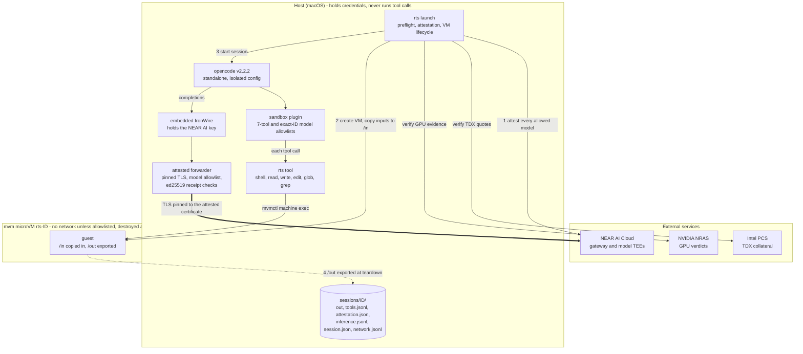

<p align="center">
  
</p>

# NEAR AI Red · SandBox

Cybersecurity Program

**AI security research in a disposable microVM, with credentials kept on your Mac.**

SandBox gives an OpenCode agent a separate environment to inspect untrusted
code, run experiments, and produce findings. Each session gets a fresh Linux
microVM. The agent's file and shell tools run inside it, the guest has no
network access by default, and files saved to `/out` are exported when the
session ends.

Part of the **NEAR AI Red Cybersecurity Program**, SandBox combines local tool
isolation with attested NEAR AI Cloud inference. You choose the inputs and
network destinations; SandBox manages the VM lifecycle and keeps session
records for review.

##  Why SandBox

- **Give the agent room to work within a defined boundary.** Shell commands
  and file operations execute in the microVM. Inputs are copied in rather
  than mounted from your working directory, and the VM is removed at teardown.
- **Keep provider credentials outside the guest.** The default inference path
  holds the NEAR AI key in a host-side proxy. Neither the guest nor OpenCode
  receives that key.
- **Choose what the guest can reach.** Start without guest network access, or
  allow specific hosts and ports before launch. Allowed and denied connections
  are logged.
- **Verify the default inference path.** Before launching, SandBox verifies
  NEAR AI's hardware attestation. During inference, it pins TLS to the attested
  certificate and checks signed response receipts. Failed checks stop the session.
- **Keep the work after the VM is gone.** Export reports and other files from
  `/out`, alongside tool-call, inference, attestation, and session records.

Use it for code review, local reproduction of suspicious behavior, and agentic
red teaming against targets you are authorized to test. The supplied guest is
minimal Alpine Linux; additional runtimes and packages require setup. SandBox
is under development and currently supports **macOS on Apple silicon**.

<p align="center"></p>

##  Install

Choose either installation method.

### Install script

```sh
curl -fsSL https://github.com/nearai/nearai-red-sandbox/releases/latest/download/install.sh | bash
```

The script installs under `~/.local` and runs `rts setup` to install and check
the pinned mvm and OpenCode versions and pull the guest image. Make sure
`~/.local/bin` is on your `PATH`.

### Homebrew

```sh
brew install nearai/tap/rts
rts setup
```

Release packages include a signed, notarized `rts` and the patched mvm
supervisor. Source builds require the [supervisor setup](docs/mvm-supervisor.md).
See the [operator reference](docs/operations.md#dependency-setup-and-verification)
for download verification and installation paths.

**Before your first session:** you need NEAR AI Cloud access with an available
organization balance. Setup also needs to download the guest image. If mvm
rejects an anonymous registry pull, use the
[authenticated pull instructions](opencode/README.md#recorded-live-validation-status),
which require Artifact Registry Reader access.

##  Quick start

```sh
rts launch
```

On first launch, SandBox opens your browser for NEAR AI Cloud sign-in. Later
launches use the saved inference key in macOS Keychain. No configuration file
is needed for the default model. Use `rts login` to sign in ahead of time or
replace the saved connection; see [account selection](docs/authentication.md)
for organizations, workspaces, and Google sign-in.

SandBox verifies the inference path, boots a fresh microVM, and opens OpenCode.
The agent's tools work in the guest even though the terminal UI runs on your
Mac. Guest network access remains off; the host still needs connectivity for
Cloud inference and attestation checks.

### Bring code in and save findings

Create an `inputs` directory containing the files you want the agent to inspect,
then save this as `session.json` next to that directory:

```json
{
  "inputsDir": "./inputs"
}
```

```sh
rts launch --config ./session.json
```

For the documented macOS archive-transport prerequisites, including GNU tar
and `PATH` setup, see the [launcher guide](opencode/README.md#how-a-session-runs).
Paths in the session file are relative to that file. The inputs are copied to
`/in` inside the guest; changes there do not modify your originals. For example,
ask the agent:

> Review the code in /in for security issues. Save a report with file references,
> reproduction steps, and suggested fixes to /out/findings.md.

Save any files you want to keep under `/out`. On teardown, SandBox exports that
directory and removes the VM. Export and cleanup failures are recorded in
`launcher.log`; check it before relying on the results. Other guest files are
discarded when the VM is removed.

### Review the results

The launcher prints the session directory. For an installed release, the default
location is `~/.local/share/nearai-red-sandbox/sessions/ID/`:

| File | What it contains |
| --- | --- |
| `out/` | Files exported from the guest's `/out` directory |
| `tools.jsonl` | Tool-call audit records |
| `attestation.json` | Evidence and verification results for the inference path |
| `inference.jsonl` | Inference and response-receipt records |
| `session.json` | Network policy, resolved addresses, and probe results |
| `network.jsonl` | Allowed and denied connections for a network-enabled session |
| `launcher.log` | Launch progress and teardown diagnostics |

Available records depend on how far the session gets and which features it
uses. The agent's findings and exported files still need your review. See the [launcher guide](opencode/README.md) for
model selection, resource limits, custom session paths, and source builds.

##  Network access

Guest network access is off by default. To reach a target or fetch packages,
allow destinations explicitly at launch:

```sh
# One target, using HTTPS port 443 by default
rts launch --config ./session.json --allow-host api.example-target.com

# The package-registry preset, including Alpine, PyPI, npm, and crates.io
rts launch --config ./session.json --allow-host packages

# A service listening on a LAN address
rts launch --allow-host 192.168.1.20:8080

# Discard any network entries in the session file
rts launch --config ./session.json --no-network
```

`--allow-host` is repeatable. Entries are fixed for the session and admit TCP
traffic through mvm's proxy; applications must support that proxy. Loopback,
cloud metadata, port 22, and other restricted destinations are refused. The
host's loopback services, including the inference proxy, remain unreachable
from the guest.

Choose destinations with care:

- **An allowed destination can receive your inputs.** The agent can send data
  it can read, including `/in`, to any admitted destination.
- **Enforcement uses IP addresses and ports.** Allowing a name on a shared CDN
  also admits other sites on the same addresses. The `packages` preset admits
  a broad set of CDN addresses; it is a convenience preset.
- **Network access adds a host process.** The `mvm-network-endpoint` process
  parses guest traffic and runs as your user without a macOS sandbox. Sessions
  without an allowlist do not start it.

Every launch probes the network policy. A failed probe, loss of the network
attachment, or an unexpected resolved address ends the session. For the full
entry syntax, package-install example, restrictions, audit files, and stop
reasons, see the [network operator reference](docs/operations.md#network-access).

##  Architecture

SandBox separates the agent's tools from its inference connection:



1. **Verify.** Check local prerequisites, authenticate, and verify the default
   Cloud inference path using Intel TDX quotes, pinned compose measurements,
   and NVIDIA GPU evidence. Attestation failures refuse launch before VM creation.
2. **Isolate.** Boot a digest-pinned guest image, copy inputs to `/in`, and
   verify the network policy. The plugin allows only its sandbox tools and
   configured model IDs, and removes MCP servers.
3. **Run.** Route file and shell tool calls into the guest. Send inference
   requests through host-side IronWire and the attested forwarder to NEAR AI
   Cloud. A failed TLS or
   response-signature check stops the session.
4. **Collect and remove.** At session end, export `/out` through an extractor
   that validates untrusted archives, retain audit records, and remove the VM.
   Sessions have a configurable time limit of 24 hours by default.

### Security boundaries

The microVM contains tool execution. OpenCode, the launcher, and inference
proxies run on the host and remain part of the trusted computing base.
Attestation verifies evidence for the configured inference deployment; it does
not validate the model's answers or make guest output safe to execute. Treat
exported files as untrusted. Response receipts are checked after streaming,
so a failed check can stop a session after OpenCode has received response bytes.
Receipts may be signed by the attested gateway or model; they are not independent
proof that a particular model generated the answer.

The attested inference behavior above describes the default embedded NEAR AI
path. External providers require an explicit opt-out of required attestation;
see [provider configuration](opencode/README.md#inference-through-embedded-ironwire).
The OpenCode footer distinguishes `attested` and `unattested` sessions.

##  Updates

```sh
rts update --check    # Check for a newer release
rts update           # Update an install made with the script
brew upgrade rts     # Update a Homebrew install
```

Installed releases check for updates at launch at most once every 24 hours.
The check has a three-second timeout and does not fail the launch. Set
`RTS_NO_UPDATE_CHECK=1` or `"updateCheck": false` in the session file to disable it.
Source builds do not run this check.

Updates use a signed release manifest and verify downloaded artifacts. See
[update verification](docs/operations.md#updates) for the signing key, manual
verification commands, `--force`, and installation behavior.

##  Project status

SandBox is under development. Its documented containment results apply to the
tested Apple-silicon Mac and pinned versions; they do not establish isolation
on other platforms. See [recorded validation](opencode/README.md#recorded-live-validation-status)
for the tested scope and the patched supervisor requirement.

- [Launcher, configuration, and source-build guide](opencode/README.md)
- [Operator reference: setup, updates, and networking](docs/operations.md)
- [Sandbox design](docs/specs/2026-10-27-sandboxed-opencode-design.md)
- [Implementation plan](docs/plans/2026-10-27-sandboxed-opencode.md)
- [Network design and measurements](docs/specs/2026-10-29-sandbox-network-access-design.md)
- [Attested inference plan](docs/plans/2026-10-28-attested-inference.md)

##  NEAR AI Cloud access

Default sessions use browser sign-in and an embedded
[IronWire](https://github.com/nearai/ironwire) proxy. The dedicated inference key
is stored in the host's native credential store and stays outside the guest.
Sign-in does not fund your account; inference uses your organization's available
balance. See the [sign-in guide](docs/authentication.md) for account selection
and external provider options.

<p align="center"></p>
