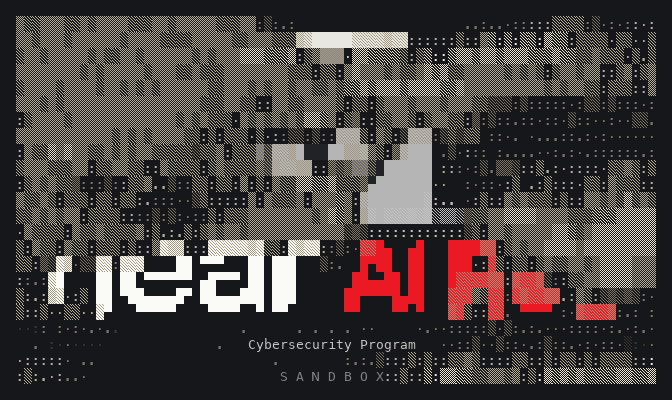
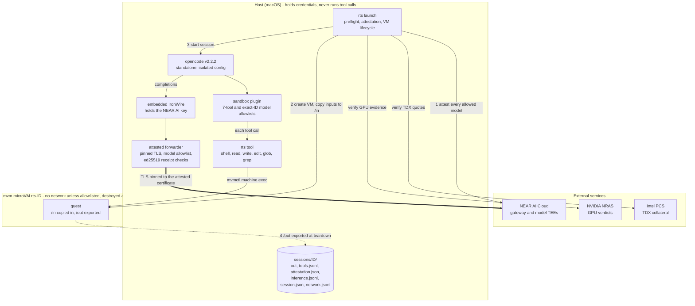

<p align="center">
  
</p>

# NEAR AI Red · SandBox

Cybersecurity Program

The microVM sandbox for **NEAR AI Red** (`near-ai-red`), supporting agentic
security research and red teaming.

This project is designed to run OpenCode tool calls inside an ephemeral microVM
per session, with no guest network unless the operator allowlists hosts for
that session, inputs copied into the guest, and results exported through
`/out`. Inference runs on the host so provider
credentials stay outside the guest.

<p align="center"></p>

##  Install

macOS on Apple silicon only. Either one-liner places a signed, notarized
`rts` and the patched mvm supervisor from a GitHub release:

```sh
curl -fsSL https://github.com/nearai/nearai-red-sandbox/releases/latest/download/install.sh | bash
```

```sh
brew install nearai/tap/rts
rts setup
```

The curl installer installs under `~/.local` (`RTS_INSTALL_PREFIX`
overrides), checks the tarball against the release's `SHA256SUMS` and, when
`gh` is installed, its build-provenance attestation, then runs `rts setup`.
Homebrew cannot write to your home directory during install, so run
`rts setup` once yourself.

`rts setup` downloads mvm v0.22.0 to `~/.local/mvm/v0.22.0/` and opencode
v2.2.2 to `~/.local/share/nearai-red-sandbox/opencode/2.2.2/`, each pinned by
sha256 and checked before it is unpacked; then it runs `mvmctl env sign`,
`mvmctl doctor`, the supervisor probes and `opencode --version`, and pulls
the pinned guest image. It never replaces an existing copy that fails
verification; it names the path to remove instead. `rts setup --check`
re-checks everything and downloads and changes nothing; `rts setup --check
--offline` checks only the installed plugin, supervisor and code signatures,
without mvmctl or the network. See the [launcher guide](opencode/README.md#installed-layout)
for where an installed `rts` finds its files.

### Updates

An installed release checks for a newer one when `rts launch` starts, at
most once every 24 hours (the result is cached in
`~/.local/share/nearai-red-sandbox/update-check.json`). The check fetches
the latest release's signed `latest.json`, gives up after 3 seconds, and
never blocks or fails the launch. A newer release prints a notice and launch
continues:

```
[rts] rts 0.2.0 is available (you have 0.1.0): run rts update
```

When the running version is below the release's oldest supported version,
the notice says it may not work. A failed check (no network, a timeout, a bad
signature) prints nothing and is recorded in the session's `launcher.log`.
`RTS_NO_UPDATE_CHECK=1`, or `"updateCheck": false` in the session config,
turns the check off; neither affects `rts update`.

```console
$ rts update            # install the newest signed release over this curl install
$ rts update --check    # only report whether a newer release exists
$ rts update --force    # reinstall the signed latest release even when it is not newer
```

`rts update` accepts only a `latest.json` signed with the update key below.
It downloads that release's `install.sh`, refuses it unless its sha256 matches
the manifest, and runs it with this install's prefix; the installer checks
the tarball against the signed digest and `SHA256SUMS` (and the attestation
when `gh` is installed), swaps the files in, and runs `rts setup`. Then
`rts update` checks that the new `rts` carries a Developer ID signature from
team `KXSWJN7WY8` and reports the signed version. `--force` skips none of
these checks. Homebrew installs update with `brew upgrade rts`: the notice
says so and `rts update` refuses. Source builds have no launch check, and
`rts update` refuses there.

The update public key (Ed25519, hex) is set as `KEY` below. To check a
release's `latest.json` against its `latest.json.sig` by hand, use OpenSSL 3
(`$(brew --prefix openssl@3)/bin/openssl`; macOS's `/usr/bin/openssl` is
LibreSSL, whose `pkeyutl` has no `-rawin`, checked 2026-10-30):

```sh
KEY=9b4a81b8bd017898c36871c6bd1cb890faf95b6e378e72eb99b9c15841f02ac9
printf '302a300506032b6570032100%s' "$KEY" | xxd -r -p > pub.der
openssl pkey -pubin -inform DER -in pub.der -out pub.pem
base64 --decode < latest.json.sig > sig.bin
openssl pkeyutl -verify -pubin -inkey pub.pem -rawin -in latest.json -sigfile sig.bin
```

The last command prints `Signature Verified Successfully`. `SHA256SUMS`
lives in the same release as the files it covers, so whoever can rewrite
release assets can rewrite it too; without the signing key they cannot
produce a `latest.json` that verifies.

##  Quick start

```console
$ rts launch    # signs in when needed, then starts a sandboxed OpenCode session
$ rts login     # optional: sign in to NEAR AI Cloud ahead of time
```

The window is titled `NEAR AI Red SandBox`, and OpenCode's home screen
ends with a line such as `NEAR AI Red · SandBox · DeepSeek V4.1 Flash
Abliterated · attested`. It says `attested` only when NEAR AI's attestation
verified for this session, and `unattested` otherwise.

On an interactive terminal, `rts launch` first shows a short splash (about
1.5 s; any key skips it, `--no-splash` turns it off; terminals smaller than
52x16 skip it), then draws its launch progress as styled status lines. With
`NO_COLOR` set, `TERM=dumb`, output that is not a terminal, or a terminal
narrower than 60 columns, it prints the same steps as plain `[rts]` lines. The
session's `launcher.log` is always plain text. opencode's own update check is
turned off, because `rts setup` pins its version.

`rts launch --config PATH` takes a session file; see the
[launcher and inference setup](opencode/README.md) for its options.

##  Network access

By default the guest has no network, and every launch proves it: after boot
the guest must fail to reach `1.1.1.1:443`, or the session is refused. A
session gets egress only to an allowlist its operator declares before launch,
fixed for the session's life:

```json
"network": {
  "allow": ["packages", "api.example-target.com", "198.51.100.7:8443", "192.168.1.20:8080"]
}
```

in the session file, plus any `--allow-host ENTRY` flags (repeatable, merged
with the config). `--no-network` drops every entry from the config, and is
refused together with `--allow-host`. An entry is the preset `packages`, a
host name (`name` or `name:port`), or an IP address with a port (`ip:port`,
IPv6 as `[addr]:port`). The port defaults to 443. There are no wildcards and
no UDP; ports 0 and 22, loopback, link-local, cloud metadata, unspecified,
multicast and `100.64.0.0/10` addresses, and more than 64 entries are refused before any VM
exists. `rts` resolves each name on the host and refuses one that does not
resolve or resolves only to a refused range.

```console
$ rts launch --allow-host packages               # pip, npm, apk and cargo registries
$ rts launch --allow-host api.example-target.com # one target, port 443
$ rts launch --allow-host 192.168.1.20:8080      # a service on this machine's LAN address
```

- **`packages`** is `dl-cdn.alpinelinux.org`, `pypi.org`,
  `files.pythonhosted.org`, `registry.npmjs.org`, `index.crates.io`,
  `static.crates.io` and `crates.io`, all on 443. The guest image has no
  curl, python or node and tool calls run without root, so install into a
  user root, for example
  `apk add --usermode --root /tmp/r --initdb --no-scripts --keys-dir /etc/apk/keys --repositories-file /etc/apk/repositories python3 py3-pip`.
- **One target** is named host by host; each entry is one host and one port.
- **A service on your own machine** must listen on a LAN address, and the
  entry names that address and port. `127.0.0.1` cannot work: mvm always
  refuses the host's loopback (and `rts` refuses `localhost`, `127.0.0.1` and
  `[::1]` entries outright). That is also what keeps the guest away from
  IronWire and the attested forwarder, which listen on `127.0.0.1` and hold
  the inference key.

The startup line says what the session got:
`network: 10 hosts allowed (packages, api.example-target.com, 198.51.100.7:8443, 192.168.1.20:8080); TCP only; every connection is logged`,
or `network: none`.

How it works: the guest has no network interface. mvm gives it an HTTP and
SOCKS proxy on `127.0.0.1:1080`, and a per-VM host process,
`mvm-network-endpoint`, admits a connection only when its destination IP and
port match an entry. Only proxy-aware programs get out; `shell` tool calls
run with `HTTPS_PROXY`, `HTTP_PROXY`, `ALL_PROXY` and `NO_PROXY` (both cases)
set to that proxy. After boot each entry is probed once from the guest, and
a failure ends the session naming the entry. Because mvm routes allowed
traffic through any proxy set in its own environment, a shell with
`HTTPS_PROXY`, `HTTP_PROXY` or `ALL_PROXY` (either case) set refuses every
launch, with or without an allowlist; so does an mvm host config that
mentions `egress`.

Before you allow a host, know what it admits:

- **Anything allowed can receive anything.** The model can send whatever it
  has, including the contents of `/in`, to any allowed destination.
  Write-capable services (code hosts, paste sites, LLM APIs) are the obvious
  channels, which is why `packages` leaves out GitHub.
- **The check is by IP, not by name.** mvm pins each name's addresses at boot
  and checks only destination IP and port, with no SNI or `Host` check.
  Allowing a host behind a shared CDN admits every other site on the same
  addresses. Measured 2026-10-29, the Alpine, PyPI and crates hosts resolve
  to Fastly (`151.101.*`) and the npm registry to Cloudflare (`104.16.*`), so
  `packages` admits a large share of those CDNs' sites on port 443: it is a
  convenience preset, not a narrow one.
- **An unsandboxed host process.** A session with any entry starts
  `mvm-network-endpoint`, which parses traffic from the hostile guest and on
  macOS runs as you with no sandbox. Sessions without an allowlist never
  start it.
- **TCP only, with no byte or rate caps.**

Where the audit lands, under `sessions/ID/`:

- `session.json`: the entries as written, the expanded list, each name's
  resolved IPs, the IPs mvm pinned, and the probe results.
- `network.jsonl`: every allowed and denied connection for this VM, copied at
  teardown from mvm's chain-signed audit log as written (still signed).
- `mvm-attach.log` (mode 0600): the output of the `mvmctl machine run` that
  keeps egress up. It echoes every exec's argv, including file contents, so
  it is never shown on the terminal or in `launcher.log`.

A session ends, exporting `/out` and removing the VM, with stop reason:

- `network-lost` when the attached `mvmctl machine run` exits, at any point.
  Egress would otherwise fail silently, and re-attaching does not restore it.
- `network-mismatch` when, after boot, the addresses mvm pinned for a name
  include one `rts` did not resolve and validate, or one in a refused range,
  or mvm recorded none. mvm records its pins only once a connection has
  succeeded, so the check follows the probes.
- `session-limit` when `limits.sessionHours` (default 24, 1 to 720) has
  passed since boot, with or without network. The attached `machine run`
  gets the same limit as its `--ttl`.

The [network access design](docs/specs/2026-10-29-sandbox-network-access-design.md)
has the measurements behind each of these.

##  Architecture



How a session runs:

1. **Attest.** After sign-in, `rts launch` fetches NEAR AI's attestation
   report for every allowed model and verifies it fail-closed: the Intel TDX
   quote (with `dcap-qvl`), the binding of signing key, TLS fingerprint and a
   fresh nonce, the pinned compose measurement, and the NVIDIA GPU verdict.
   Any failure refuses the session before a VM exists.
2. **Boot.** A fresh microVM with no network interface boots from a
   digest-pinned image, and the operator's inputs are copied into `/in`. With
   an allowlist, its only way out is mvm's proxy, limited to the listed hosts
   and ports (see [Network access](#network-access)). Every launch probes
   this: each allowed entry must connect, and a session with no allowlist
   must fail to reach `1.1.1.1:443`.
3. **Run.** opencode runs on the host. The sandbox plugin replaces its file
   and shell tools so every tool call executes in the guest; every other tool,
   MCP server, and non-allowlisted model is removed. Completions go through
   IronWire and the attested forwarder, which pins TLS to the attested
   certificate and checks NEAR AI's signature on every response. A failed
   check ends the session.
4. **Tear down.** On exit, signal, a fatal check, or the session time limit
   (`limits.sessionHours`, default 24), `/out` is exported through
   a hostile-archive extractor and the VM is removed. Audit records stay in
   `sessions/ID/`.

The guest is treated as hostile: it never sees credentials, has no network
beyond the hosts its operator allowlisted for the session (none by default),
can never reach the host's loopback, where IronWire and the forwarder listen,
and can only return files through `/out`.

##  Project status

The implementation is under development. Source builds on macOS need the
patched mvm supervisor described in the [setup guide](docs/mvm-supervisor.md)
before launching; releases ship it. The pinned guest image is in a public Google Artifact Registry
repository; see the launcher guide for access and setup.

- [Design](docs/specs/2026-10-27-sandboxed-opencode-design.md)
- [Implementation plan](docs/plans/2026-10-27-sandboxed-opencode.md)
- [Network access design](docs/specs/2026-10-29-sandbox-network-access-design.md)
  and [plan](docs/plans/2026-10-29-sandbox-network-access.md)
- [Attested inference plan](docs/plans/2026-10-28-attested-inference.md)
- [Launcher and inference setup](opencode/README.md)
- [NEAR AI Cloud sign-in](docs/authentication.md)

##  NEAR AI Cloud access

`rts launch` uses browser sign-in and an embedded
[IronWire](https://github.com/nearai/ironwire) proxy by default. Credentials are
stored in the host's native credential store and stay outside the guest. See
the [sign-in guide](docs/authentication.md) for account selection and external
provider configuration.

<p align="center"></p>
