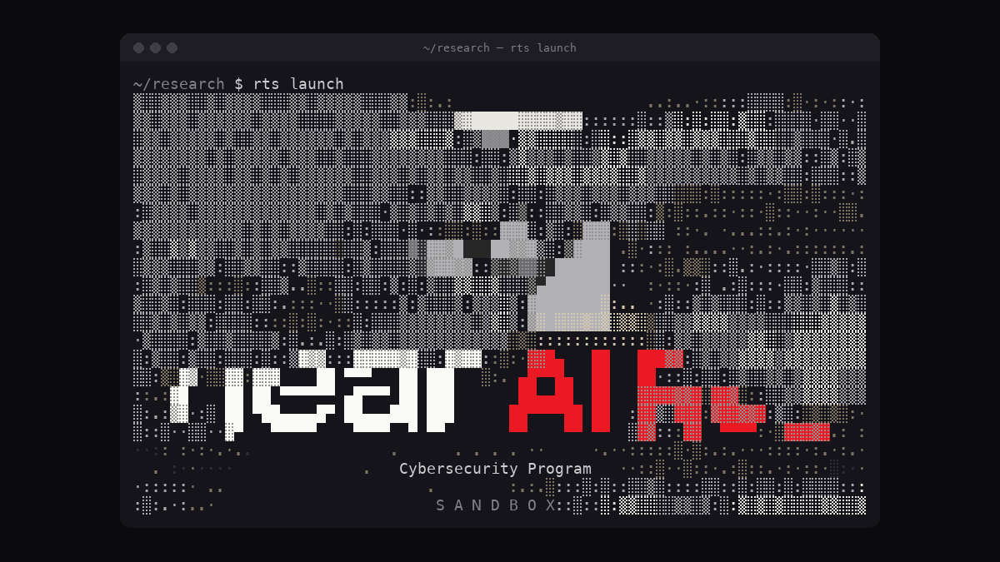
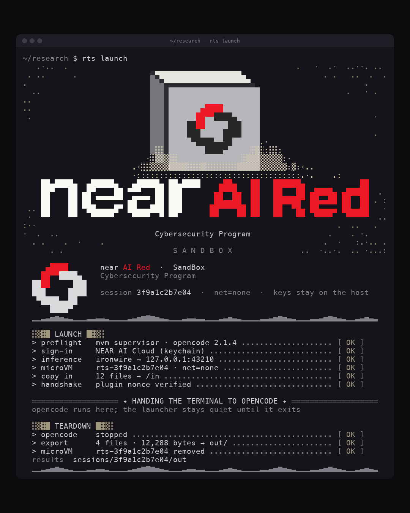

# SandBox launch posts

Post templates for the SandBox launch on X and LinkedIn, in three voices, with the media to attach.
[index.html](index.html) is the same content with copy buttons, live character counts and a toggle to each post's earlier draft; open it in a browser.
Replace `[link]` before posting. X counts a link as 23 characters, and the counts below already do.

## Media

| | File | Use |
| --- | --- | --- |
|  | [splash-x-1200x675.gif](splash-x-1200x675.gif), 1200 × 675, loops | X, or LinkedIn landscape. Alt text: A terminal window runs rts launch. A sandstorm of ASCII characters clears to reveal a grey cube with the red and black NEAR AI Red mark, above the words near AI Red, Cybersecurity Program and SandBox. |
|  | [session-linkedin-1080x1350.png](session-linkedin-1080x1350.png), 1080 × 1350 | LinkedIn feed, 4:5. Alt text: A terminal window shows the rts launch splash, then the launch log: preflight, sign-in, inference, microVM with net=none, copy in and handshake all report OK. Teardown exports 4 files to out/ and removes the microVM. |
|  | [sandbox-splash.gif](../../assets/sandbox-splash.gif), 672 × 400, the README hero | Anywhere the plain splash fits. Alt text: A sandstorm of ASCII characters clears to reveal a grey cube with the red and black NEAR AI Red mark, above the words near AI Red, Cybersecurity Program and SandBox. |

## Irreverent / provocative

Hacker-scene swagger, short lines, a wink at 1337 culture. Sounds like someone who has run a sample on their own laptop and regrets it.

### X · 239 / 280 · attach Splash GIF, 16:9

```text
Dear 1337 h4x0rs (defensive division),

we gave NEAR AI's new cybersecurity models a burner VM. No network, no keys, no regrets. Feed it the binary you're scared of, watch it work, then torch the box.

$ rts launch

[link]
```

<details><summary>Earlier draft · 254 / 280</summary>

```text
Calling all 1337 h4x0rs (the defensive kind).

NEAR AI's new cybersecurity models now come with a throwaway microVM. No network. No keys inside. Point the agent at that sketchy binary, let it rip, then nuke the box.

$ rts launch

[link]
```

</details>

### LinkedIn · 831 / 3000 · attach Splash GIF, 16:9

```text
Your laptop is not a malware lab. We've all pretended otherwise at 2am.

So we gave NEAR AI's new cybersecurity models somewhere else to work: the NEAR AI Red SandBox. Every session gets its own microVM. The agent tears into the sample in there, and your machine, your network and your API keys stay well out of it.

The box, in short:
→ fresh microVM per session, gone when you close it
→ guest networking off by default (allowlist hosts if you must, every connection logged)
→ keys live on the host, the VM never sees them
→ files go in, findings come back out through /out

It's built for the defensive 1337 haxxor crowd. Reverse engineering, malware triage, that one sample from the ticket nobody wants to touch.

One command to start:
$ rts launch

Still early, so tell us what breaks. [link]

#infosec #reverseengineering #AI
```

<details><summary>Earlier draft · 773 / 3000</summary>

```text
Your laptop is not a malware lab. Stop treating it like one.

The NEAR AI Red SandBox gives NEAR AI's new cybersecurity models a throwaway microVM to work in, so your agent can tear apart that sketchy binary while your machine, your network and your API keys stay out of it.

What's in the box:
→ A fresh microVM every session, gone when you're done
→ Guest networking off by default. Allow a host only if you mean it.
→ API keys stay on the host. The VM never sees them.
→ Files go in. Findings come out through /out.

Built for the defensive 1337 haxxor crowd: reverse engineering, malware triage, and poking at things you'd never run on bare metal.

One command:
$ rts launch

Go break something (safely): [link]

#cybersecurity #reverseengineering #redteam #infosec #AI
```

</details>

## Academic / technical

Precise and measured. States the threat model and the four properties, and is honest about what isn't new.

### X · 254 / 280 · attach Session image, 4:5

```text
We've put NEAR AI's new cybersecurity models behind a microVM boundary.

Per session: one VM, discarded at teardown. No guest network by default. Inference and credentials stay on the host. Inputs copied in, results out via /out.

[link]
```

<details><summary>Earlier draft · 279 / 280</summary>

```text
NEAR AI Red SandBox: ephemeral microVM isolation for agentic security research.

· One microVM per session, discarded at teardown
· Guest networking off by default
· Inference and credentials stay on the host
· Inputs copied in, results exported via /out

[link]
```

</details>

### LinkedIn · 1198 / 3000 · attach Session image, 4:5

```text
A short note on where the agent runs.

Defensive security work (reverse engineering, malware analysis) asks an AI agent to inspect, and often execute, code nobody trusts. We think the agent's environment deserves as much scrutiny as the model, so NEAR AI's new cybersecurity models now run inside the NEAR AI Red SandBox: an ephemeral microVM per session.

The properties we rely on:

1. Isolation. Each OpenCode session executes its tool calls in its own microVM, discarded at teardown.
2. No egress by default. Guest networking is off unless specific hosts and ports are allowlisted at launch, and every allowed or denied connection is logged. An analyzed sample has nowhere to phone home.
3. Credential separation. Inference runs on the host through NEAR AI Cloud, so provider credentials never exist inside the guest.
4. Explicit data flow. Inputs are copied in. Results leave through one directory, /out. Nothing else crosses.

None of this is novel on its own. The point is having all four by default, every session, without a researcher assembling them by hand.

The implementation is still under development. Design notes and setup guide: [link]

#AIsecurity #reverseengineering #sandboxing
```

<details><summary>Earlier draft · 1106 / 3000</summary>

```text
Introducing the NEAR AI Red SandBox: an isolation layer for agentic security research.

Defensive security work such as reverse engineering and malware analysis requires an AI agent to inspect, and often execute, untrusted code. The SandBox confines that activity to an ephemeral microVM with four properties:

1. Isolation. Each OpenCode session executes its tool calls in a dedicated microVM that is discarded at teardown.
2. No egress by default. Guest networking is off unless specific hosts are allowlisted at launch, so analyzed artifacts cannot reach external hosts.
3. Credential separation. Model inference runs on the host through NEAR AI Cloud; provider credentials are never present in the guest.
4. Explicit data flow. Inputs are copied into the guest, and results are exported through a single /out directory.

Together, these let researchers evaluate NEAR AI's new cybersecurity models on realistic defensive and reverse-engineering workloads without extending trust to the workload itself.

Design document and setup guide: [link]

#AIsecurity #cybersecurity #reverseengineering #sandboxing
```

</details>

## Expert / informative

A practitioner talking in the first person. Concrete samples, a clear first step, no sales voice.

### X · 277 / 280 · attach Splash GIF, 16:9

```text
Pointing an AI agent at a suspicious binary? Put it in a box first.

NEAR AI Red SandBox runs NEAR AI's new cybersecurity models in a throwaway microVM per session. No guest network by default, keys stay on the host, results land in /out.

$ rts launch

[link]
```

<details><summary>Earlier draft · 277 / 280</summary>

```text
Using an AI agent on suspicious binaries? Run it in a box.

NEAR AI Red SandBox runs NEAR AI's new cybersecurity models in a fresh microVM per session: no guest network by default, API keys stay on the host, results come out through /out.

$ rts launch

[link]
```

</details>

### LinkedIn · 985 / 3000 · attach Session image, 4:5

```text
Something I keep telling people who use AI agents for security work: where the agent runs matters at least as much as which model it is.

An agent doing reverse engineering will execute things. That's the job. So the real question is what else that code can reach while it runs.

The NEAR AI Red SandBox answers that by wrapping NEAR AI's new cybersecurity models in a microVM per session:

• a new microVM every session, removed when you're done
• guest networking off by default, with an explicit allowlist when you need one
• inference on the host, so your API keys never enter the VM
• inputs copied in, results exported to /out

In practice, you can hand the agent a packed sample, a crash dump or that binary out of a phishing kit, let it dig in, and the worst case is one disposable VM.

Starting a session is one command, rts launch. It signs you in to NEAR AI Cloud and opens a sandboxed OpenCode session.

Docs and setup: [link]

#infosec #reverseengineering #malwareanalysis
```

<details><summary>Earlier draft · 806 / 3000</summary>

```text
If you use AI agents for security work, where the agent runs matters as much as which model it uses.

The NEAR AI Red SandBox gives NEAR AI's new cybersecurity models a safe place to work:

• A fresh microVM for every session, removed when the session ends
• Guest networking off by default, with an explicit allowlist when you need one
• Inference on the host, so API keys never enter the VM
• Inputs copied in, results exported to /out

That makes it practical to hand an agent a suspicious binary, a crash dump or a packed sample and let it dig in, knowing the blast radius is one disposable VM.

Getting started takes one command:
$ rts launch
It signs you in to NEAR AI Cloud and opens a sandboxed OpenCode session.

Learn more: [link]

#cybersecurity #AI #reverseengineering #infosec #malwareanalysis
```

</details>

## Regenerating the media

The GIF and the session image are rendered from the terminal demo:

```sh
python3 scripts/splash/render_social.py
```

It needs Pillow and macOS's Menlo font, like `render_gif.py`.
